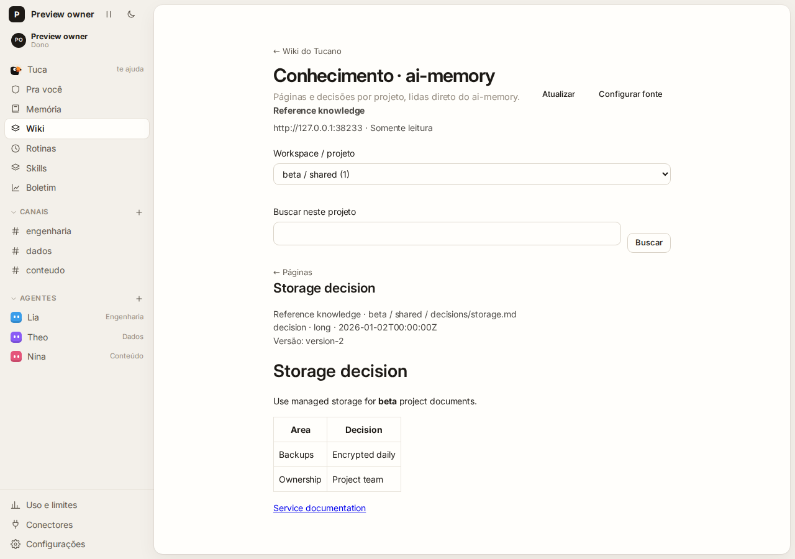

# Read ai-memory in Tucano

The owner can browse one ai-memory source from **Wiki → Knowledge · ai-memory**. Choose **Connect ai-memory**, enter a name, the service origin accessible from the Tucano server (for example `https://memory.example.com`), and an ai-memory read token. The service must have its HTTP API enabled. Use a dedicated read identity restricted to the intended projects.

Choose a workspace/project, open a page, or search within that project. Page provenance includes source, workspace, project, path, update timestamp and version ID. **Refresh** reads the source again and removes the previous display while loading. Search returns at most 50 results. Access failures and unavailable services appear explicitly; they are not shown as empty collections.

**Configure source** requires a fresh token when saving, including when changing the URL. Saving replaces the source identity and invalidates references from the previous connection. **Disconnect source** removes the saved credential. A workspace copy excludes this connection and credential.

## Boundaries

- Only the owner can configure or read this source, enforced by the core RPC policy. Administrators and members cannot use its credential.
- The renderer sends the token once from a password field. The core keeps it in the existing vault; responses, snapshots and events contain no credential. Nonsecret source metadata stays in database metadata.
- Pages are read live through fixed ai-memory v3.4.4 `/api/v1` endpoints. There is no content mirror or persistent cache. All redirects are refused; requests expire after 10 seconds and responses are limited to 4 MiB and 10,000 records per collection.
- The native Wiki, personal memory, conversation summaries and agent grants remain separate. Browsing a page does not inject it into a prompt or grant an agent access.
- Markdown renders without raw HTML or remote image loads. Absolute HTTP(S)/email links can be opened separately. Relative links remain text in this first version.
- This integration does not enable ai-memory's API, create identities or change deployment networking. Configure those separately in the private deployment.

## Verify locally

```sh
env -u CODEX_HOME npm run typecheck
env -u CODEX_HOME npx vitest run test/knowledge.test.ts test/knowledge-core.test.ts test/people-roles.test.ts test/workspace-data.test.ts test/rpc-fuzz.test.ts
env -u CODEX_HOME npm run build
```

The HTTP tests use synthetic loopback servers and disposable databases. They cover API shapes, namespaces, authentication failures, revocation, stale source references, traversal, redirects, malformed/oversized responses, request timeout, credential redaction, owner RPC enforcement and workspace-copy isolation.

For a visual check, start a disposable Tucano instance with fake engines and a test ai-memory service. As owner, connect it from the Wiki, switch between identically named projects in different workspaces, search, open Markdown, and refresh after revoking the test token. Reopen configuration: the password must be empty. Confirm the native Wiki is still reachable, keyboard navigation works, and the page fits a narrow browser. Never use production credentials in fixtures or screenshots.

## Preview



[Phone-sized preview](images/external-knowledge-mobile.png). Both images use synthetic local data.
