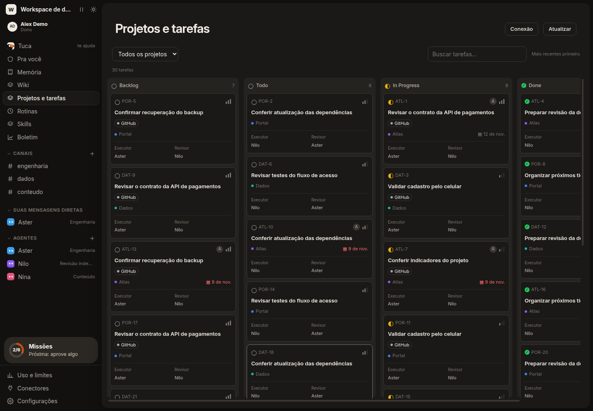
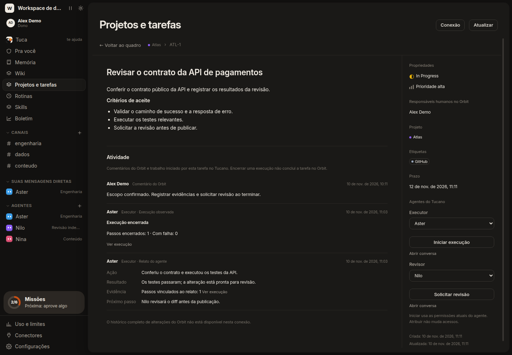
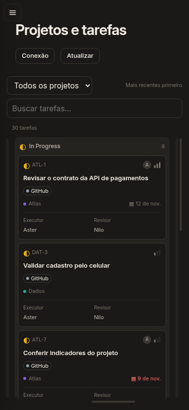
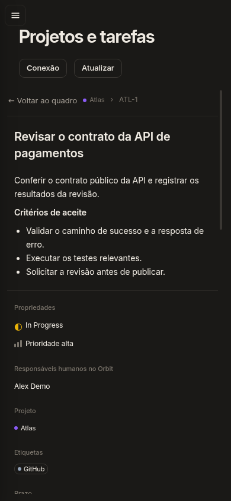

# Orbit board and agent activity

Projects and tasks shows the Orbit projects allowed by your read token. Filter a project, open a card and assign a Tucano executor or reviewer. Starting work is a separate action and uses that agent's existing permissions.

Each task thread records execution attempts and agent reports with Action, Result, Evidence and Next step. Reports are the agent's claims; observed execution state remains separate. Retry retains the previous message and its evidence. Finishing a reply does not change the task's Orbit status.

The connection reads Orbit comments and properties. Orbit's public API does not expose its complete audit history or manual card order. The board uses newest-created order and marks counts as partial while more task pages remain.

## Browser evidence

These screenshots use invented projects, accounts, tasks and reports from `node scripts/orbit-preview.mjs`. The real Tucano server renders the UI against a local Orbit fixture. Seeded reports illustrate the layout; Runner tests verify actual task execution and reporting separately.

Schema 39 stores task executions and activity. Preserve a pre-upgrade data copy before deployment; rollback restores that copy with its matching previous image. See [fork maintenance](fork-maintenance.md).
